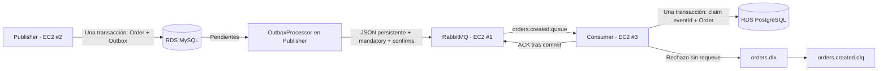

# Arquitectura y garantías

## Evolución

master: OrderRepository.save confirma MySQL antes del envío. Si el broker falla, la orden queda persistida sin mensaje. No hay transacción distribuida.

secure: OrderService crea Order + OutboxEvent en una misma transacción. El scheduler, cada dos segundos, pide un lote de hasta diez eventos pendientes bajo bloqueo pesimista. Mantiene el bloqueo durante la publicación (simple pero limita throughput); se recomienda un solo worker para la demo.
Por evento, espera hasta cinco segundos el publisher confirm. NACK, timeout, excepción o mandatory return mantienen el evento pendiente. Solo ACK sin return permite marcar sent_at.
Los intentos Outbox se repiten en ciclos sucesivos hasta recuperar el broker; **no se aplica el límite de tres del consumidor** a Outbox.

Si RabbitMQ confirmó y el proceso cae antes del commit de sent_at, el evento se enviará otra vez. Por ello Outbox y publisher confirms no reemplazan la idempotencia.

## Consumo e idempotencia

EventCodec aplica tamaño máximo de 16 KiB, JSON estricto, esquema explícito y Jakarta Validation.
OrderCreatedEvent contiene UUID eventId y correlationId, orderId positivo, occurredAt, eventType=OrderCreated y payload mínimo (customerId y amount).
No se aceptan fechas a más de cinco minutos en el futuro; los eventos antiguos siguen siendo válidos para recuperación.

OrderService ejecuta en PostgreSQL:

1. INSERT de eventId con ON CONFLICT DO NOTHING.
2. Si fue insertado, guardar la fila de negocio en la misma transacción.
3. Si existía, indicar duplicado sin repetir el negocio.
4. Retornar después de commit; entonces el listener hace ACK manual.

La PK de processed_events resuelve carreras entre consumidores. Si falla el negocio, también se revierte el registro de eventId.
RabbitMQ puede reentregar tras pérdida de conexión o de ACK; un mensaje marcado redelivered no implica necesariamente que el negocio ya se haya ejecutado.

## Errores

- Transitorios (acceso temporal a datos, fallo de recurso o apertura de transacción): hasta 3 intentos totales, pausa de 500 ms.
- Permanentes: rechazo inmediato sin requeue, enviado por el broker a DLX/DLQ.
- Modo pedagógico demo.retry-invalid=true: un evento estructurado inválido hace 3 intentos para visualizar retry → DLQ; no se recomienda en producción.
- JSON malformado: rechazo inmediato en todos los modos.
- Un error I/O enviando ACK no vuelve a ejecutar el negocio dentro del mismo listener.
- El límite de reintentos es por entrega en memoria. Reinicios pueden repetir entregas; la protección del negocio es persistente.

La cola y DLQ son classic durables; los mensajes publicados son persistentes.
El dead lettering classic por defecto no garantiza transferencia sin pérdida si el destino no está disponible. Para producción evaluar quorum queues y políticas de dead lettering at-least-once, alarmas y recuperación.
La cola original y el contenido del evento cambian entre ramas: usar vhosts y bases separados, o una migración real planificada.
