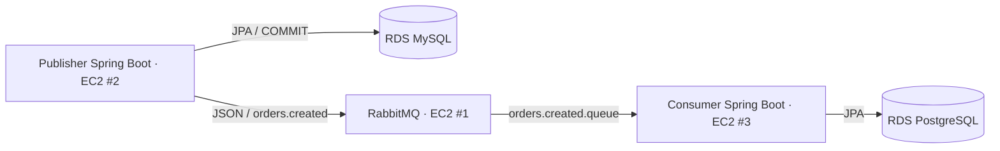

# Arquitectura

Topología mínima: exchange directo durable `orders.exchange`, routing key `orders.created`, cola durable `orders.created.queue`.
Ambos servicios declaran la misma topología de forma idempotente. Cada proyecto tiene su propio modelo y pom.xml; no comparte entidades JPA.

Publisher usa CommandLineRunner → OrderService → OrderRepository.save (commit) → OrderPublisher → RabbitTemplate.
Consumer usa @RabbitListener → Jackson → OrderService → OrderRepository.save.

El ack automático sucede cuando el listener termina normalmente. En master no personalizamos ACK/NACK.
La persistencia de la cola no resuelve la transacción distribuida entre la base de datos y el broker.
